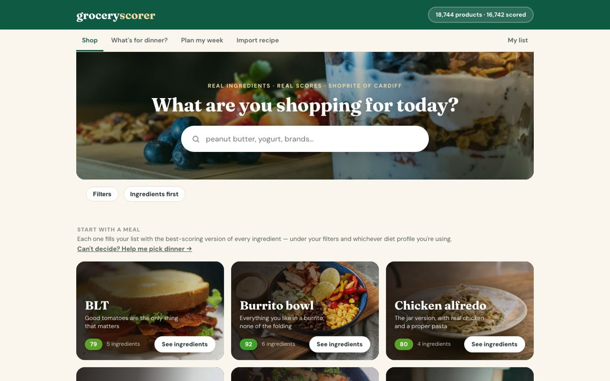
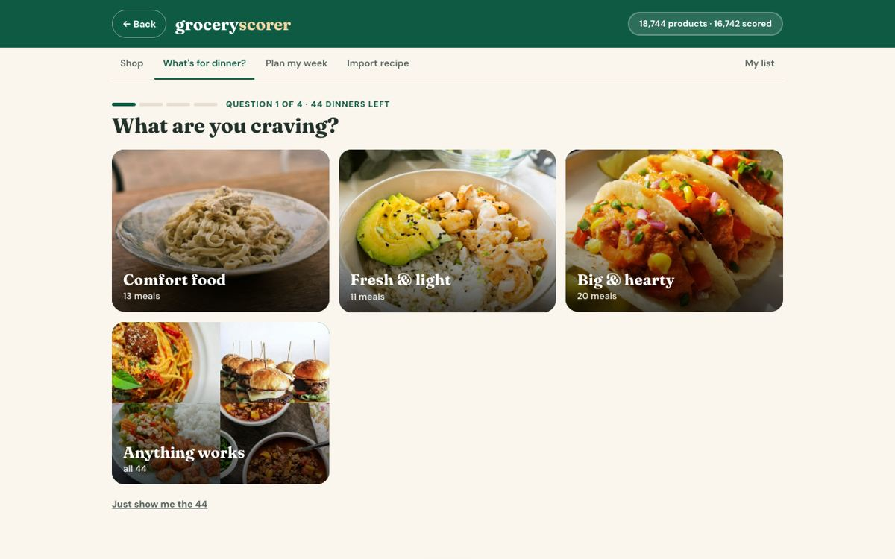
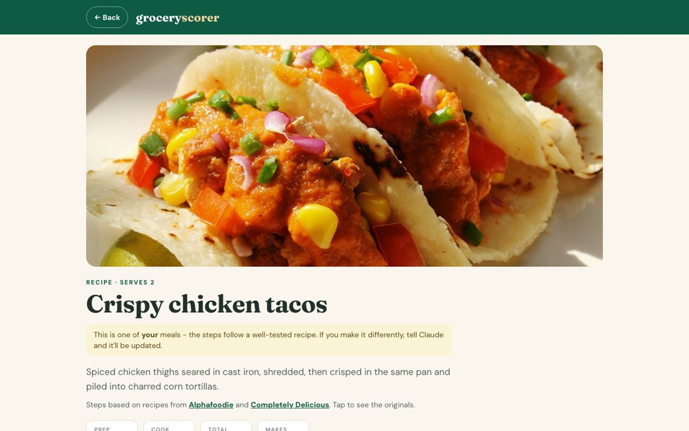
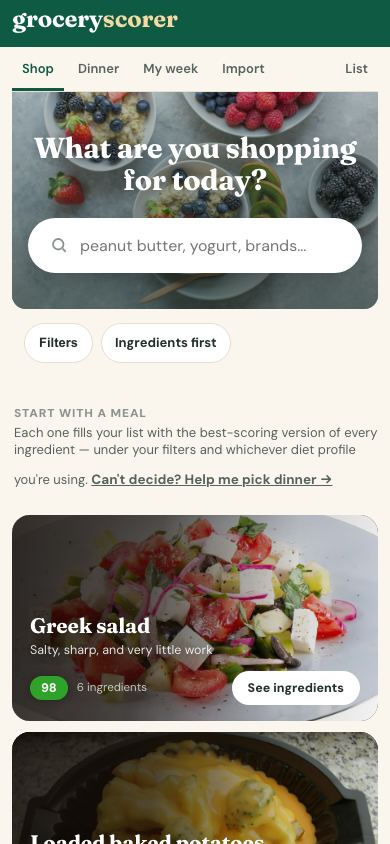

# GroceryScorer

A personal project: a grocery app that scores every product at my local supermarket from 0 to 100
on how healthy it actually is, based on its ingredient list and nutrition label, with the
research behind every rule written down and cited.



## What it does

- **Scores 18,700+ products** from my local store. Tap any product to see why it scored what it
  did: how many ingredients, which ones are flagged and why, and what the nutrition label says.
- **Builds a shopping list** grouped by aisle, picking the healthiest version of each item.
- **Plans meals:** 73 meals and a "what's for dinner?" picker. Every meal has a full recipe based
  on well-reviewed published recipes, credited and linked.
- **Imports recipes** from a link or pasted text and finds the healthiest version of each ingredient.
- **Reads a label from a photo** and scores it by the same rules.

| Dinner picker | Recipe page | On a phone |
|---|---|---|
|  |  |  |

## The part I care most about: evidence, not opinion

Every scoring rule had to be backed by research and checked against real products.

- **Evidence grading.** Each additive or sweetener gets a write-up grading the evidence as Strong,
  Moderate, Weak or Contested, separating human studies from animal or lab work and comparing the
  dose studied with the amount actually in a serving. See [`research/topics/`](research/topics/),
  for example [sucralose](research/topics/sucralose.md), [aspartame](research/topics/aspartame.md)
  and [erythritol](research/topics/erythritol.md).
- **Regulators side by side.** Where IARC, EFSA, JECFA and the FDA disagree (aspartame is the
  classic case), the write-up explains why and what it means at real intakes.
- **Every change tested before it's made.** A rule change is simulated across the whole catalog
  first, and the before/after is written up in [`SCORING_NOTES.md`](SCORING_NOTES.md). Example:
  products were being judged partly on whether an outside database happened to rate them, so two
  near-identical mozzarellas scored 87 and 96. The fix moved 2,154 scores and was only applied
  after the whole-catalog results were reviewed.
- **Data quality checks.** A weekly audit looks for scores that don't add up: nutrition labels
  whose calories don't match their fat, carbs and protein, footnotes read as ingredients, a "zero
  sugar" soda listed with 44 g of added sugar. Each one is traced to its cause before anything is
  fixed.

Try the scoring engine without any store data:

```bash
python3 examples/score_a_label.py
```

```
Natural peanut butter: 97.8        (2 ingredients, no added sugar)
Conventional peanut butter: 45.2   (hydrogenated oil, added sugar, seed oil)
Cola: 15                           (capped: 39 g added sugar in one serving)
Prebiotic soda: 63.8               (4 g added sugar, 7 ingredients)
```

## How it was built

I designed and directed the project; the code was written with **Claude** (Anthropic's AI) as a
pair programmer. My part was deciding what to build, setting the health rules and challenging
scores that looked wrong. One example: a prebiotic soda scoring only 7 points above Coca-Cola led
to a sugar-dose rule. I chose between designs and approved every scoring change after reviewing
the evidence and the simulated effect. Two AI agents run on a schedule: one researches one food
additive a day, one audits the scores weekly. Neither can change a score without my approval.

Built over about a month, in 114+ saved versions. A visual timeline of every stage, from the first
five peanut butters to today, is in [`docs/history/`](docs/history/index.html).

## What's in this repository

| Folder | What's there |
|---|---|
| `scoring/` | The scoring engine (`scorer.py`), its ingredient flags and severities, carcinogen references, diet profiles, the weekly audit and the what-if simulator |
| `research/` | The evidence write-ups and the research log |
| `app/` | The web app (pages, meals, recipes, photos) |
| `examples/` | A runnable demo of the scorer |
| `docs/` | Screenshots and the project history |

Not included: the product catalog collected from the store's website and the tools that
collected it, which stay private.

Meal photos are from Unsplash (free to use, see `app/assets/meals/LICENSE.txt`). Recipe steps
are rewritten in my own words and link to the published recipes they're based on.
